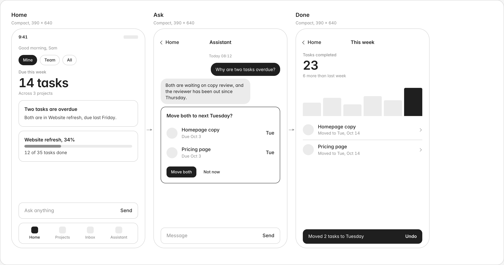

# Megamind Labs UI

A greyscale wireframe kit for getting projects working before you design them. Seven greys, one typeface, and grey squares where icons and photos will go. One CSS file, no build step, no JavaScript required.

**[Browse the components and 26 starter screens](https://gitcamy.github.io/megamind-labs-ui/)**



Made by [Megamind Labs](https://megamindlabs.ai).

## Connect your AI tool

Megamind Labs UI is an MCP server. Connect it to your AI tool, then ask for screens: "Wireframe a sign-up flow with Megamind Labs UI." Your tool's own model writes the screens, following the kit's rules, and checks them before showing you.

```
https://megamind-labs-ui-mcp.megamind-labs.workers.dev/mcp
```

**Claude (web and desktop):** Settings → Connectors → Add custom connector → paste the URL above.

**Claude Code:**

```bash
claude mcp add --transport http megamind-labs-ui https://megamind-labs-ui-mcp.megamind-labs.workers.dev/mcp
```

**Codex:**

```bash
codex mcp add megamind-labs-ui --url https://megamind-labs-ui-mcp.megamind-labs.workers.dev/mcp
```

**Cursor:** add to `~/.cursor/mcp.json`:

```json
{ "mcpServers": { "megamind-labs-ui": { "url": "https://megamind-labs-ui-mcp.megamind-labs.workers.dev/mcp" } } }
```

ChatGPT, Gemini, Antigravity and VS Code are covered in [`server/README.md`](server/README.md#connect-the-mcp-server).

Tools: `get_rules`, `get_reference`, `list_components`, `get_component`, `get_starter`, `scaffold_flow`, `validate_screen`. There is also a `wireframe` prompt.

## Use the stylesheet directly

**Plain HTML:** link the stylesheet and put `class="mm mm-canvas"` on `<body>`.

```html
<link rel="stylesheet" href="https://cdn.jsdelivr.net/gh/gitcamy/megamind-labs-ui@main/megamind-labs-ui.css">
```

`screens/starter.html` is a blank flow to duplicate. The full class and token list is in [`reference/classes.md`](reference/classes.md).

**React:** copy `react/MegamindLabsUI.jsx` into your project and import the stylesheet once.

**Without MCP:** paste [`PROMPT.md`](PROMPT.md) into your AI tool. Agents can also read [`AGENTS.md`](AGENTS.md) and [`llms.txt`](llms.txt).

## Theming

Everything is a CSS variable on `:root`, so override them after the stylesheet. Add `data-theme="dark"` to any element for the dark palette. The one color is `--mm-accent` (#6D8ECA light, #E3F988 dark), applied by the kit to badges, pressed chips, dots, steps and the active tab.

## Principles

1. **Grey means undecided.** Fills stand in for anything not designed yet.
2. **Ink means it matters.** Near-black only for the primary action, the active state, and the key number.
3. **One line weight.** Every border is 1px in the same grey.
4. **No color, even for errors.** Danger is a dashed outline.
5. **Real words.** Write the actual copy, never lorem ipsum.

## Contributing

Issues and pull requests are welcome. Keep additions greyscale, built from existing tokens, and usable without JavaScript. Add a specimen to `index.html` for anything new.

## License

MIT. Use it for anything, including client work.
