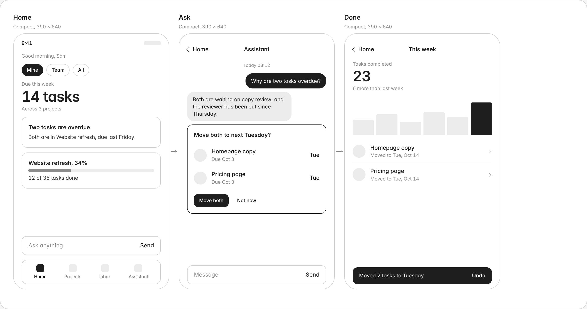

# Megamind Labs UI

A greyscale wireframe kit for getting projects working before you design them. Seven greys, one typeface, and grey squares where icons and photos will go. One CSS file, no build step, no JavaScript required.

**[Browse the components and 26 starter screens](https://gitcamy.github.io/megamind-labs-ui/)**



Made by [Megamind Labs](https://megamindlabs.ai).

## Use it

**Plain HTML:** link the stylesheet and put `class="mm mm-canvas"` on `<body>`.

```html
<link rel="stylesheet" href="https://cdn.jsdelivr.net/gh/gitcamy/megamind-labs-ui@main/megamind-labs-ui.css">
```

`screens/starter.html` is a blank flow to duplicate. The full class and token list is in [`reference/classes.md`](reference/classes.md).

**React:** copy `react/MegamindLabsUI.jsx` into your project and import the stylesheet once.

**Claude Code:** install the plugin, then ask for screens in plain words.

```
/plugin marketplace add gitcamy/megamind-labs-ui
/plugin install megamind-labs-ui@megamind-labs-ui
```

**Other AI tools:** paste [`PROMPT.md`](PROMPT.md) into Claude, v0, Lovable or Cursor, or connect the MCP server (setup in [`server/README.md`](server/README.md)). Agents can also read [`AGENTS.md`](AGENTS.md) and [`llms.txt`](llms.txt).

**Generator:** open `generate.html`, describe a screen by typing or voice, and Claude builds it from the kit. It uses your own Anthropic API key, which stays in your browser. Copy the result as markup, React or a full page.

## Theming

Everything is a CSS variable on `:root`, so override them after the stylesheet. Add `data-theme="dark"` to any element for the dark palette. The one color is `--mm-accent` (#6D8ECA light, #E3F988 dark), applied by the kit to badges, pressed chips, dots, steps and the active tab.

## Principles

1. **Grey means undecided.** Fills stand in for anything not designed yet.
2. **Ink means it matters.** Near-black only for the primary action, the active state, and the key number.
3. **One line weight.** Every border is 1px in the same grey.
4. **No color, even for errors.** Danger is a dashed outline.
5. **Real words.** Write the actual copy, never lorem ipsum.

## Contributing

Issues and pull requests are welcome. Keep additions greyscale, built from existing tokens, and usable without JavaScript. Add a specimen to `index.html` for anything new.

## License

MIT. Use it for anything, including client work.
